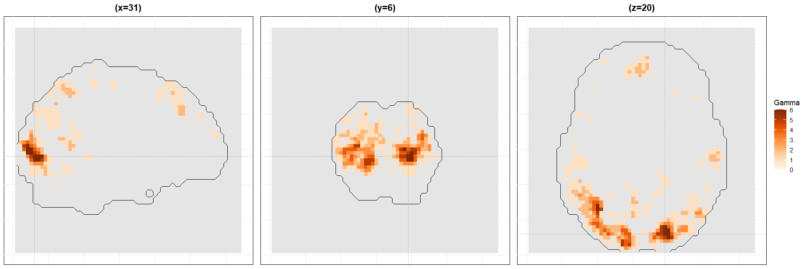
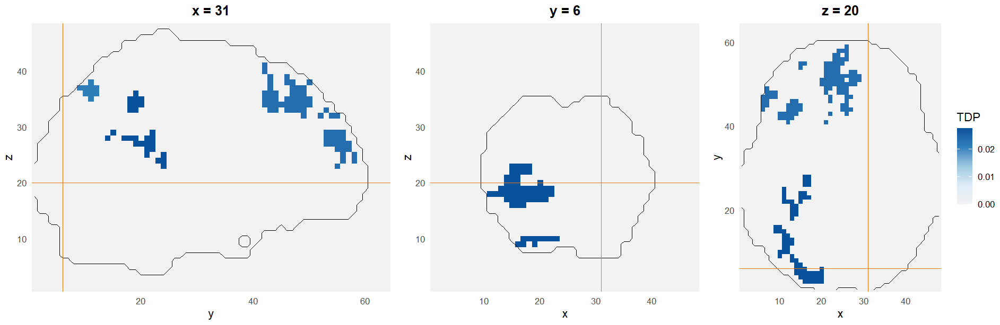

# Quantifying the Consistency of Neural Signals

**A subject-prevalence analysis of neuroimaging data** · M.Sc. thesis in Statistical Sciences (Data Science), University of Bologna, 2026

[**Interactive Shiny dashboard**](https://dilabulanik.shinyapps.io/neurovault_2447/) · [**Thesis (PDF)**](Thesis_Dila_Nur_Bulanik.pdf)


*Voxel-wise lower bounds on the number of active subjects (N = 10, α = 0.05). Darker voxels are active in more subjects, with a simultaneous confidence guarantee.*

---

## The question

Standard fMRI group analyses average across subjects. They tell you *where* the brain responds on average, but not *how many people* actually show the effect. A strong group result can be driven by a small subgroup.

This project asks a complementary question: **at each voxel, how many subjects show evidence of activation?**

## Approach

- **Subject-prevalence inference.** Each voxel is treated as a family of N subject-level hypotheses. Using closed testing (Goeman & Solari, 2011) with Hommel/Simes local tests, the method computes, for every voxel, a lower confidence bound on the number of active subjects.
- **Simultaneous guarantee.** The bounds hold simultaneously across all voxels at level 1 − α, so regions can be selected *after* looking at the data without invalidating inference (no "double dipping").
- **u-out-of-N maps.** Thresholding the bound map at u gives the regions active in at least u of N subjects, which makes it easy to see how conclusions change from subgroup-level effects to effects shared by the majority.
- **Comparison with ARI.** Results are compared with All-Resolutions Inference (Rosenblatt et al., 2018), which bounds the proportion of active voxels within clusters.

## Data

Public subject-level t-statistic maps from [NeuroVault collection #2447](https://neurovault.org/collections/2447/), contrast *noun/verb judgement > baseline* (N = 10 subjects, m = 67,224 voxels in the analysis mask). The data are downloaded automatically through the NeuroVault API.

## Key results

| Active in at least u subjects | Voxels | % of mask |
|---|---:|---:|
| u ≥ 1 | 13,102 | 19.49 |
| u ≥ 2 | 4,246 | 6.32 |
| u ≥ 3 | 1,477 | 2.20 |
| u ≥ 5 (majority) | 180 | 0.27 |
| u ≥ 8 | 4 | 0.01 |
| u ≥ 9 | 0 | 0.00 |

- About 19.5% of the brain mask is certified active in at least one subject, but only 0.27% in at least half of the subjects.
- Strong, widely shared activation is rare and concentrated in a few contiguous regions.
- Prevalence maps and ARI highlight broadly similar regions, while answering different questions.


*ARI lower bounds on the true discovery proportion within clusters (τ = 3.2, clusters ≥ 20 voxels), for comparison.*

## Interactive dashboard

The [Shiny app](https://dilabulanik.shinyapps.io/neurovault_2447/) lets you navigate brain slices, filter voxels by minimum prevalence level and inspect the bound at any voxel with a crosshair.

## Repository structure

```
├── R/
│   ├── 01_download_and_preprocess.R   # NeuroVault download, mask, p-values
│   ├── 02_prevalence_bounds.R         # closed testing, prevalence map, summary table
│   └── 03_ari_comparison.R            # group-level ARI comparison
├── figures/                           # figures used in this README
└── Thesis_Dila_Nur_Bulanik.pdf
```

## How to run

Requires R (≥ 4.2) and the packages `httr`, `jsonlite`, `RNifti`, `hommel`, `ARIbrain` and `pARI`.

```r
install.packages(c("httr", "jsonlite", "RNifti", "hommel", "ARIbrain", "pARI"))

source("R/01_download_and_preprocess.R")   # downloads data into data/
source("R/02_prevalence_bounds.R")         # writes results into output/
source("R/03_ari_comparison.R")
```

Scripts are run from the repository root, in order. Data and outputs are created locally and are not tracked in the repository.

## Limitations

- Small sample (N = 10), which limits how fine-grained prevalence statements can be.
- Degrees of freedom are not available in NeuroVault, so p-values use a normal approximation.
- The mask is the union of non-zero voxels across subjects, which is conservative but includes weakly supported regions.

## Author

**Dila Nur Bulanık** · Supervisor: Prof. Anna Vesely · [LinkedIn](https://linkedin.com/in/dila-bulanik)
